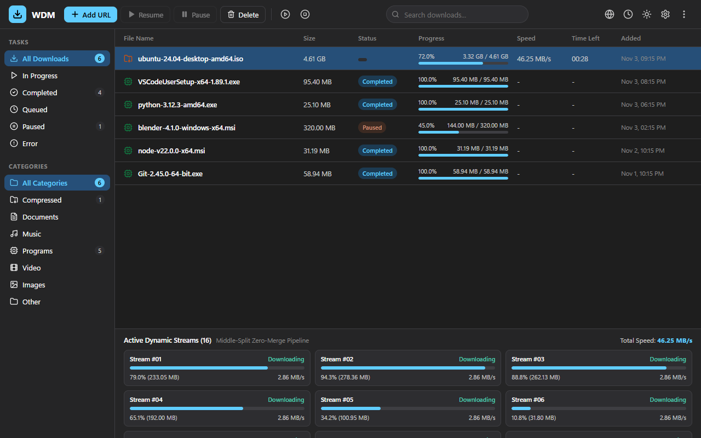
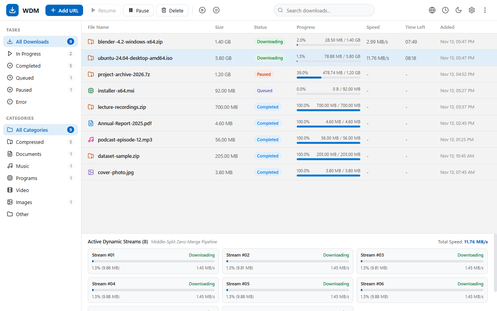

# WDM — Windows Download Manager

A high-performance, multi-connection download manager for Windows built on the **Modern Native Stack (Rust + Tauri v2 + React / TypeScript)**, with Chrome/Edge/Brave/Firefox integration.
WDM is an independent implementation: its behaviour was modelled on what IDM does (observed from its documented
options, settings keys and native-messaging layout), but it shares no code, assets or branding with it.



<details><summary>Light theme</summary>



</details>

## Download

Get the installer from the [latest release](https://github.com/md-anamul-hasan/wdm/releases/latest) (Windows 10/11, 64-bit; standalone native, lightweight memory footprint) and check it against `SHA256SUMS.txt`. Release builds are to be code-signed with a free certificate from the [SignPath Foundation](https://signpath.org/) (see [Code signing policy](#code-signing-policy)).

## What it does

| Area | WDM behaviour |
|---|---|
| Segmentation | Splits a file across up to 32 connections; idle connections split the largest active segment (`DynamicSegmenter` with middle-split) |
| Storage | Zero-merge: workers write straight into their offset of a pre-allocated file (`StorageWriter`) |
| Resume | `.wdm-state` checkpoints with ETag/Last-Modified validation; ranges are verified (a server that ignores `Range` falls back safely instead of corrupting the file) |
| Request context | Referer, cookies, user agent and basic auth travel with every request; cookies are only sent to the host they were captured for and credentials to the original host, never across a redirect to another host or over an https→http downgrade |
| Credential protection | Credentials stored using Windows DPAPI encryption with entropy `WDM.secret.v1` (`dpapi1:<base64>`) |
| Download list | Persisted in `%APPDATA%\WDM\downloads.json`; interrupted downloads come back paused and resumable |
| Queue & scheduler | Start/stop queue, daily start/stop times, 30 s auto-retry of failed items, optional shutdown when the queue finishes |
| Single instance | Later launches (browser, command line) hand their download to the running window over a per-user named pipe (`WDM.Ipc.<username>`) |
| Browser integration | MV3 extension + `wdm-nativehost` (stdio native messaging). The extension takes over matching downloads **only after WDM confirms**; otherwise the browser download resumes untouched |
| System tray | Full tray lifecycle: minimize to tray, tray menu (Open WDM, Pause All, Resume All, Exit) |
| Other | Speed limiter (token-bucket with debt handling), unknown-length (chunked) downloads, batch download, site grabber, stream visualizer, YouTube-style pages via bundled `yt-dlp`, dark/light Fluent theme |

### Command line (`wdm.exe` / `wdm-desktop.exe`)

```
wdm-desktop.exe /d <url> [/p <folder>] [/f <filename>] [/sha256 <hex>] [/n] [/a]
```
`/n` start silently without the dialog · `/a` add to the queue without starting · `/sha256` verify integrity · a bare URL also works. Backwards-compatible `Wdm.Ui.exe` alias is provided.

`wdm <url> [-o dir] [-c connections] [-l KB/s] [--sha256 <hex>]` is the standalone terminal downloader (`wdm.exe` / `Wdm.Cli.exe`).

## Build, test, install

Prerequisites:
- [Rust](https://rustup.rs/) (1.80+)
- [Node.js](https://nodejs.org/) (20+)

```powershell
# Build workspace binaries (Debug or Release)
cargo build --workspace

# Run complete test suite (93 tests)
cargo test --workspace

# Run browser extension tests (21 tests)
node --test "tests/extension/*.test.mjs"

# Publish everything to dist\WDM and register the native messaging host
.\scripts\publish.ps1
```

Installer: `.\scripts\build-installer.ps1` builds a self-contained `dist\installer\WDM-Setup-<version>.exe` (needs Inno Setup 6: `winget install JRSoftware.InnoSetup`). Both scripts download the pinned `yt-dlp.exe` and LGPL `ffmpeg.exe` listed in `scripts/tools.lock.json` and verify their SHA-256 (see `THIRD_PARTY_NOTICES.md`); neither is stored in the repository. The version comes from `Cargo.toml`.

Release for a website: `.\scripts\package-release.ps1` writes `dist\release\` with the installer, a zip of the extension and `SHA256SUMS.txt`.

Chrome Web Store submission: `.\scripts\package-extension.ps1` builds the store zip, and `store/chrome/listing.md` has the listing text, permission justifications and reviewer instructions.

Install the extension from the [Chrome Web Store](https://chromewebstore.google.com/detail/wdm-download-manager-inte/flnbghmpkajibfdfhbcfhkcjkhlokfgi) ("WDM Download Manager Integration"; Chrome, Edge, Brave), or load it manually: `chrome://extensions` → Developer mode → **Load unpacked** → select `extension\`.
`wdm-nativehost --register` authorizes both the store extension (`flnbghmpkajibfdfhbcfhkcjkhlokfgi`) and the sideloaded one (`kdjgcdbahccolkkagbckkchfpcchcfne`, pinned by the manifest key).
Use `wdm-nativehost --unregister` to remove the registration.

Set `WDM_DATA_DIR` to relocate settings and the download list (portable mode / testing).

## Layout

```
crates/wdm-core        Rust download engine: HTTP range segmentation, resume state, persistence, DPAPI crypto, zero-merge direct storage writer, named pipe IPC, site grabber, and media resolver
crates/wdm-cli         Standalone terminal downloader (wdm.exe / Wdm.Cli.exe)
crates/wdm-nativehost  Browser Native Messaging Host (wdm-nativehost.exe / Wdm.NativeHost.exe)
crates/wdm-desktop     Tauri v2 application core (wdm-desktop.exe / Wdm.Ui.exe)
src-ui/                React 19 + TypeScript + Vite frontend
extension/             MV3 browser extension (Chrome/Edge/Brave; Firefox id included)
installer/             Inno Setup script (installer/wdm.iss)
scripts/               publish.ps1, build-installer.ps1, package-release.ps1, fetch-tools.ps1
Cargo.toml             Root workspace definition and product version
```

## License

[MIT](LICENSE). Bundled third-party tools keep their own licenses: `yt-dlp` (Unlicense) and `ffmpeg` (LGPL build from [BtbN/FFmpeg-Builds](https://github.com/BtbN/FFmpeg-Builds); source is available from [ffmpeg.org](https://ffmpeg.org/download.html)).

## Code signing policy

Free code signing for release builds is provided by [SignPath.io](https://about.signpath.io/), with a certificate from the [SignPath Foundation](https://signpath.org/).

- Status: signing is not active yet; the installers published so far are unsigned. The workflow signs a release only when the repository variable `SIGNPATH_ORGANIZATION_ID` is set, which happens after approval.
- Releases are built and signed only by the GitHub Actions workflow `.github/workflows/release.yml` from tagged commits of this repository.
- Only WDM's own binaries and its installer are signed; bundled third-party tools are not.
- Maintainer and approver: Md Anamul Hasan ([@md-anamul-hasan](https://github.com/md-anamul-hasan)).

## Privacy

Full policy: [docs/PRIVACY.md](docs/PRIVACY.md).

WDM sends no telemetry and has no update check. It connects only to the servers you download from (and, for video-site pages, to whatever `yt-dlp` contacts for that site). Settings and the download list stay in `%APPDATA%\WDM` on your machine.

## Command line
`wdm <url> [-o <dir>] [-c <connections 1-32>] [-l <KB/s>] [--sha256 <hex>]` — full reference: [docs/CLI.md](docs/CLI.md)

| Exit code | Meaning |
|---|---|
| 0 | download completed |
| 1 | error (bad URL or checksum text, HTTP error, I/O error) |
| 2 | finished, but the file does not match `--sha256` (data kept as `<name>.wdm-part`) |
| 130 | paused with Ctrl+C; run the same command again to resume |

Unfinished downloads are written to `<name>.wdm-part` and renamed when complete, so a half-downloaded file never appears under its real name.
