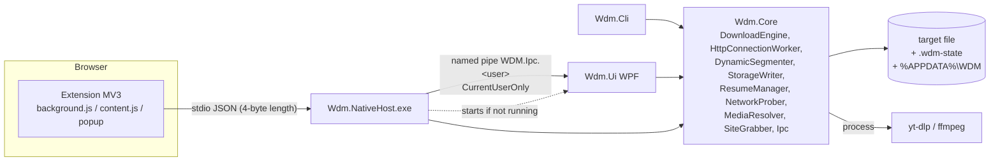

# Architecture audit

Verified against source (not the README). Size: Core ≈ 2.9 kLOC, Ui ≈ 3.4 kLOC view-model + 0.55 kLOC code-behind + 0.9 kLOC XAML, NativeHost 0.3 kLOC, Cli 0.2 kLOC.

## Dependency direction
`Ui`, `Cli`, `NativeHost` → `Core`; Core references nothing but the BCL. **No cycles** (checked from project files). Core is platform-neutral, which is why 106 tests run on Linux.

## Strengths
- Small, cohesive engine: one worker class per HTTP connection, segment table guarded by a single lock in `DynamicSegmenter`, direct offset writes (`RandomAccess`), atomic temp+rename for checkpoints and settings.
- Manual redirect loop keeps credentials bound to their host (`HttpRequestHelper`).
- IPC is minimal (one JSON document per connection, size capped).

## Weaknesses (and what was done)
| Area | Finding | Action |
|---|---|---|
| Resume trust | Checkpoint treated as trusted | Fixed (AUD-001/004) |
| Durability ordering | Checkpoint before data flush | Fixed (AUD-010) |
| `MainViewModel` | One class split over 5 partials, ≈1.5 kLOC, owns downloads, scheduler, modals, persistence, filtering | Not refactored (WPF runtime not testable here; refactor without UI tests is high risk). Scheduler decision logic extracted to `Core.Models.ScheduleTrigger` and unit-tested. |
| `MainWindow.xaml.cs` | 553 lines of code-behind | Open |
| Static state | `WdmPipe.Name`, `AppSettings.DataDirectory` are static/env-driven → tests that touch them must be serialised (xunit collection `NamedPipe`) | Documented |
| Sync-over-async | `NetworkProber.CheckpointUrl` blocks on an async file read; `App.OnStartup` blocks ≤3 s on pipe send | Low impact; open |
| `async void` | One (`OnAnalyzeGrabberClick`, event handler) | Acceptable; not runtime-verified |
| Error swallowing | `DownloadStore.Save` / `AppSettings.Save` swallow IO errors silently → the user is never told settings/list weren't saved | Open (P3) |
| Process execution | yt-dlp via `ArgumentList` + `--`; resolver looked up beside the exe, then on `PATH` (a `yt-dlp.exe` earlier on `PATH` than expected is a planting risk only if the app dir lacks one; installer bundles it) | Informational |
| Duplicated URL logic | HTTP(S) validation exists in Core and again in extension JS | Intentional (trust boundary) |

## Scalability
Per download: ≤32 connections, 64 KB buffers from `ArrayPool`; the UI keeps all rows in memory and persists the whole list as one JSON file (1 s debounce). Fine for thousands of rows; not benchmarked in the UI.
